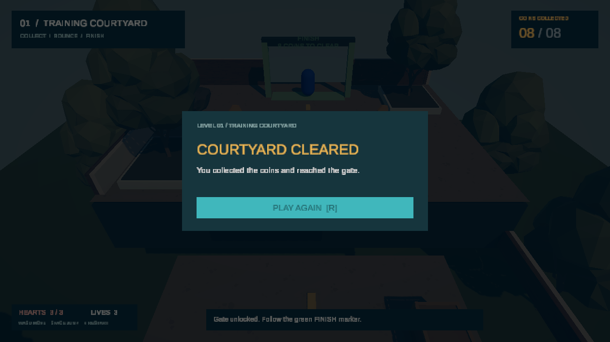

# Level01 - Training courtyard

## Authored scene

Open `Assets/Scenes/Level01.unity` in Unity 6000.3.24f1. The scene was edited directly through Unity MCP: Synty prefab instances were placed, colliders and materials configured, and references assigned in the Inspector's serialized components. Geometry is saved in the scene and prefab assets. There is no procedural scene builder or runtime scene-generation component.

The scene hierarchy separates structure, garden dressing, route signs, gameplay, HUD, camera and lighting. Source Synty assets are reused through instances; A3 gameplay wrappers live in `Assets/Prefabs/A3/`.

## Play

- Move: WASD or arrow keys, relative to the follow camera.
- Jump: Space.
- Restart: R, or the button on either result panel.
- Collect at least 8 of the 10 coins, then enter FINISH. Collecting the target alone does not end the level.
- Hold forward when entering the bounce pad and steer onto the raised balcony.
- The balcony activates a checkpoint. Jump forward across the last gap to reach the exit garden.
- A fall costs one life. After a short pause, respawn at the start or balcony checkpoint, standing still and temporarily protected. Coins remain collected until a full restart.
- The last of three lives produces the lose panel. Both result panels freeze time and have working restart buttons.

No enemy or damaging obstacle is introduced in this first level. Its fall zone still allows the life, respawn and lose loop to be demonstrated.

## Current tuning

| Setting | Value | Reason |
|---|---|---|
| Coin target / available | 8 / 10 | Requires the route's collections while allowing two pickups to be missed. |
| Movement speed | 5 m/s | Retains the A2 controller's walking/jumping behavior; the crossings were verified with actual movement input. |
| Jump height | 1.8 m | Clears the last 3 m gap without a bounce, while the 3 m raised balcony requires the pad. |
| Coyote time | 0.1 s | A short grace window after leaving an edge; does not replace the need to jump. |
| Jump buffer | 0.12 s | Accepts a slightly early Space press before landing. |
| Fall multiplier | 2.2 | Keeps the A2 jump apex while shortening descent. |
| Bounce launch | 11.5 m/s, VelocityChange | One upward kick independent of mass; normal horizontal steering remains active. |
| Bounce crossing | 4 m gap, 3 m rise | Teaches the additional force; verified by holding forward onto the balcony. |
| Final crossing | 3 m gap, equal height | A normal Space jump, verified independently from the bounce. |
| Lives / hearts | 3 / 3 | Allows recovery while leaving a clear, reachable lose state. |
| Respawn delay | 0.8 s | Makes the lost life visible before returning control. |
| Respawn protection | 1.5 s | Prevents immediate damage on return. |
| Health i-frames | 1 s | Shared Health already rejects repeated damage; damaging hazards arrive in later levels. |

These are the implemented values, not the final assignment's complete tuning table. Patrol, chase, knockback, crusher and timed power-up tuning remain for later phases.

## Gameplay scripts

- `GameManager` owns score, lives, TMP updates, respawn and the result/restart loop.
- `Coin` checks the built-in Player tag on the contacting Rigidbody, counts once, disables its trigger and hides the pickup.
- `BouncePad` resets vertical velocity and applies a single upward VelocityChange. Its trigger extends beyond the physical rim so walking into it does not snag the capsule.
- `Checkpoint`, `FallZone` and `FinishGate` notify the scene's GameManager through physics triggers.
- `Health` initializes before the manager, clamps hearts at zero and rejects damage during i-frames or respawn.
- A3's player omits A2's immediate fall-result component. The inherited movement and camera remain reusable; CameraFollow has a snap method for respawn.

## Verification

The saved scene passed Unity MCP scene validation with zero missing scripts, broken prefabs or other reported issues. A temporary Play-mode check used actual input events, physics contacts and pointer clicks; it created no scene geometry or persistent testing component.

All 21 checks in [the recorded result](Level01-PlayChecks.json) passed. They cover fresh score/hearts/lives, the locked finish, one-time coin collection, a steered bounce, checkpoint activation, the normal jump, fall/life accounting, protected respawn, retained coins, the last-life lose state, eight physical pickups, winning, both clickable restart buttons and full pickup restoration.

Remaining A3 work: original Level02-Level05 layouts, guards, shared damaging hazards and knockback, a warned crusher, timed power-ups, the final demonstration video, the student's short answers and final submission review.
