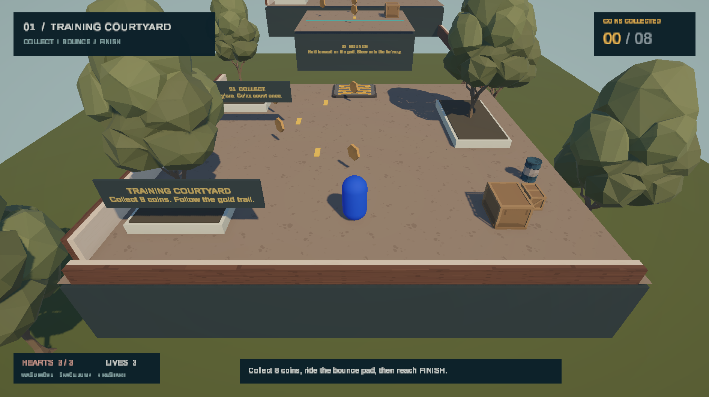
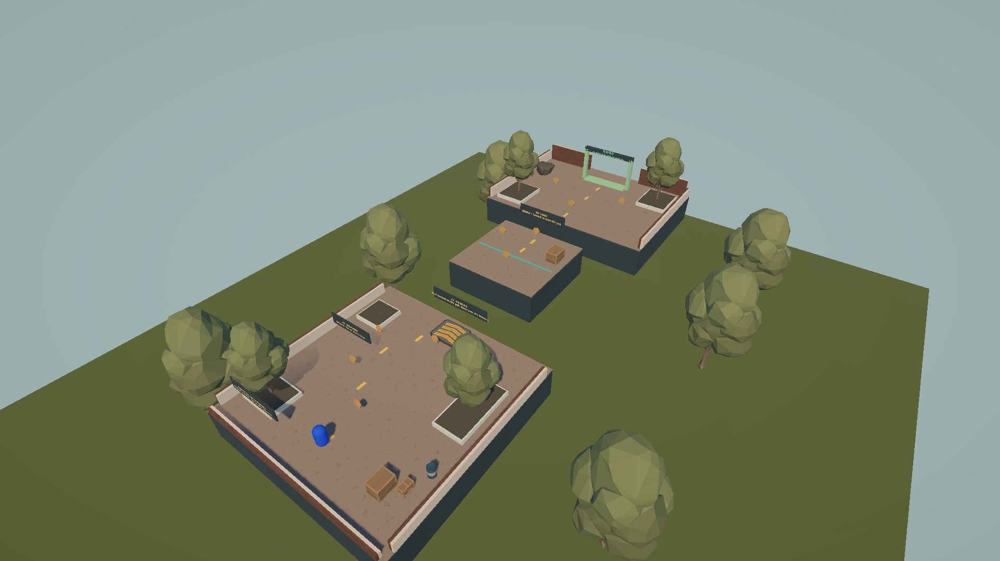

# CS464 Assignment 03 - BSCS23204

Collect, Dodge, Survive - Lectures 06-07.

## Project status

Level01 is now a new, playable Synty training courtyard, authored directly in Unity through MCP. Its objects, colliders, UI and prefab instances are saved in the scene; there is no scene-generation script. Level02-Level05 remain inherited foundation scenes awaiting their new A3 layouts and mechanics.

- **Started from:** [Assignment 02](https://github.com/arty542/CS464-A2-bscs23204), development commit `7d1a697`.
- **Unity:** 6000.3.24f1 (Unity 6.3).
- **Working branch:** `development`; merge a pull request into `main` when ready for marking.
- **Foundation:** Rigidbody movement, camera-relative controls, height-based jumping, coyote time, jump buffering, faster falling, landing squash and smooth camera following.
- **MCP:** Connected to the A3 editor. Level01 passed 21 Play-mode checks, including actual movement input and clicks on both restart buttons.
- **New levels:** The instructor requires fresh A3 layouts, also used for Lab 6. Level01 has been replaced with an original courtyard/balcony/garden route. The remaining inherited layouts are temporary and will be replaced.
- **Controls:** WASD or arrow keys to move; Space to jump; R to restart. Win and lose panels also have clickable restart buttons.
- **To win Level01:** Collect at least 8 of its 10 coins, then enter the green FINISH gate. Hold forward on the bounce pad to reach the balcony; use Space and forward for the final gap.
- **Video:** Pending. Add a public 60-120 second YouTube or Google Drive link, never the video file.

## Planned phases

**Visual kit:** Use the instructor's Synty PolygonGeneric and PolygonPrototype packages for five new spaces in an overgrown industrial courtyard setting. The [asset shortlist](Docs/a3/Synty-Asset-Selection.md) records selected prefabs, supplied materials, gameplay roles and integration checks.

| Phase | Work | Completion check |
|---|---|---|
| 0 - Foundation | Import A2 code and history; retain A3 MCP configuration; use development. | Verify ancestry, remotes, packages and asset references; Unity play verification remains pending. |
| 1 - Fresh layouts | Build original Level01-Level05 using the reusable player, camera and asset kit. | Clear starts, readable routes and reachable finishes; no reused layouts. |
| 2 - Collect and win | Coin prefab, at least five coins per scene, GameManager, TMP score, win panel, restart and bounce pad. | Coins count once, win freezes time, restart restores time, and the force works. Compare the Lab 6 handout with these new levels before preparing that submission. |
| 3 - Damage and survival | Shared Hazard script, spikes, visible knockback, Health with i-frames, TMP hearts/lives, fall zone, protected respawn and lose/restart. | Accepted hits cause one knockback, recovery prevents repeated damage, falls cost a life, and the last life ends the game. |
| 4 - Guards | Three or more waypoints, distance-based arrival, Patrol/Chase/Return, separate detection and give-up ranges, contact damage. | Guards chase slower than the normal player run, give up and return to patrol. |
| 5 - Crusher and power-up | Warned crusher and timed speed boost with a player-owned timer. Planned second-pickup rule: refresh duration without stacking speed. | Crusher warns for at least 0.5 seconds; boost survives pickup destruction, refreshes deliberately and expires correctly. |
| 6 - Integration | Teach one new idea per level before combining it with earlier mechanics; tune routes and recovery. | Every scene can be won, lost and restarted; all five are in the Build Profiles Scene List. |
| 7 - Submission | Five screenshots, measured tuning table, four short answers, demo video, final checks and PR into main. | Fresh clone works; screenshot/video links open; public repository is ready for LMS submission. |

## Level01 - Training courtyard

The safe courtyard teaches collection and the bounce pad. Its balcony activates a checkpoint, then a normal jump leads to the exit garden. Falling consumes one of three lives and returns the player to the latest checkpoint, keeping collected coins; losing the last life shows the lose panel. Winning and losing freeze time, and either restart button restores time before reloading.

The reusable Coin, BouncePad, PlayerA3 and HUD prefabs are in `Assets/Prefabs/A3/`. The level has no damaging enemies or obstacles yet. See [Level01 implementation notes](Docs/a3/Level01-Notes.md) and the [21 passed Play-mode checks](Docs/a3/Level01-PlayChecks.json).

## Intended level progression

These are new designs to build, not descriptions of the inherited A2 scenes.

| Level | New idea | Combined with |
|---|---|---|
| Level01 | Coins, goal and bounce pad | Safe introduction without damaging obstacles; a fall can still lose a life. |
| Level02 | Spikes and damage recovery | A safe demonstration followed by a risky coin detour. |
| Level03 | Patrol, chase and escape | Open guard routes with previously taught spikes. |
| Level04 | Crusher timing | A safe warning demonstration before mixing with guards. |
| Level05 | Timed speed boost and second pickup | Two reachable pickups, earlier mechanics and a ping-pong guard. |

## Final write-up to complete after playtesting

Add `Docs/a3/level01.png` through `level05.png`, a screenshot table, the final win condition and video link.

Record actual values and reasons for patrol speed, chase range, knockback and ForceMode, i-frame duration, power-up duration and any additional tuning.

Write the required answers in your own words about the finished code:

1. Why does a trigger need a Rigidbody on at least one object?
2. Which ForceModes do knockback and the additional force use, and why?
3. What happens when a second power-up is collected during an active effect?
4. Why can equality fail for waypoint arrival, and when can it work?
