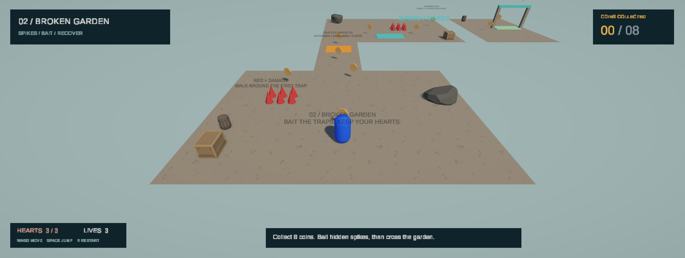
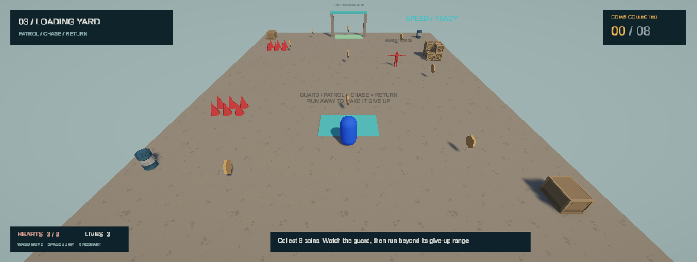
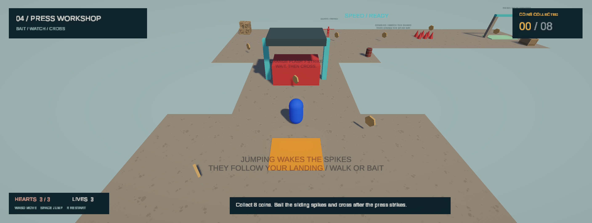
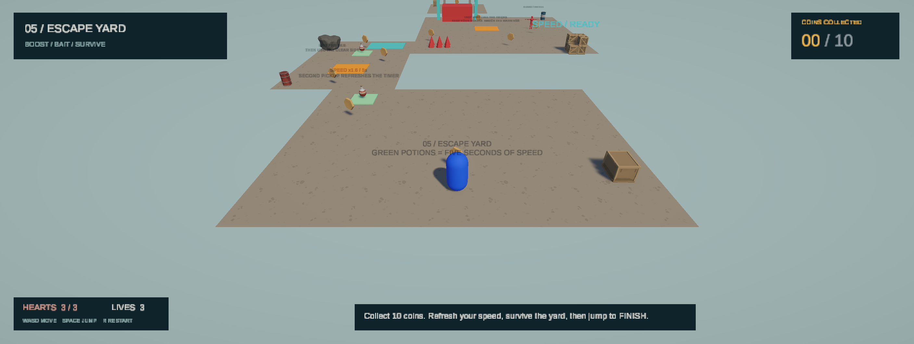

# CS464 Assignment 03 — BSCS23204

**Collect, Dodge, Survive** · Unity 6000.3.24f1 · Lectures 06–07

Five original levels using the instructor's Synty PolygonGeneric and PolygonPrototype assets, with the movement and camera foundation from Assignment 02.

## Run

1. Open this folder in Unity **6000.3.24f1** and let packages import.
2. Open `Assets/Scenes/Level01.unity` and press Play, or build the five enabled scenes in Build Profiles.
3. Use **WASD / arrows** to move, **Space** to jump and **R** to restart. Both result panels have clickable restart buttons. Winning also offers the next level; the final level returns to Level01.

Collect **8 of 10 coins** in Levels 1–4 and **10 of 12** in Level 5, then enter the green FINISH gate. Each level starts with three hearts and three lives. Damage uses a shared one-second invulnerability window; empty hearts or a fall consume one life. Respawning keeps collected coins and returns to the latest checkpoint. Restart resets that level completely.

## Level progression

| Scene | New idea and route | Combination |
|---|---|---|
| Level01 — Training Courtyard | Safe coin collection, bounce launch to a raised balcony, checkpoint, then a normal gap jump. | Teaches score, finish, falling, lives and restarting without damaging obstacles. |
| Level02 — Broken Garden | A visible spike bed teaches damage before a concealed proximity trap on the bridge. Approach, back away, then cross during its cooldown. | Hearts, knockback, a checkpoint and a sideways jump to the separate finish island. |
| Level03 — Loading Yard | A four-waypoint loop in an open yard; watch patrol, enter its detection range, then outrun the guard. Its label shows Patrol / Chase / Return. | Previously introduced spike beds and risky coin detours. |
| Level04 — Press Workshop | A jump wakes sliding spikes that follow the player's landing X. An orange warning precedes the crusher strike. | A checkpoint after the press, a guard and an eastward spike bay. |
| Level05 — Escape Yard | Two speed potions demonstrate refreshing the timer without stacking speed; the clear outside lane provides room to learn the boost. | Concealed spikes, sliding spikes, a ping-pong guard, a crusher and a final gap jump. |

The concealed and jump-reactive spikes take inspiration from **Level Devil** and **Trap Adventure 2**. They are hidden at rest, with an orange footprint and a short warning before damage, and use the same Hazard/Health system as ordinary spikes and guards.

| Level | Screenshot |
|---|---|
| 01 |  |
| 02 |  |
| 03 |  |
| 04 |  |
| 05 |  |

## Implementation

- `GameManager` owns score, lives, checkpoint respawn, result panels and scene changes. It resets `Time.timeScale` before every restart or next-level load.
- `Coin` is a reusable trigger prefab. A Player tag check and a collected flag ensure each pickup counts once.
- `EnemyPatrol` uses a kinematic Rigidbody, `MovePosition`/`MoveTowards`, at least three assigned waypoints and a distance threshold. Detection and give-up ranges differ to prevent rapid state switching. Guards operate on open ground; the assignment does not require obstacle navigation.
- `Hazard` is shared by spikes, guards and crushers. Only an accepted `Health.TakeDamage` call produces a flat outward impulse. The movement controller yields control during knockback, including jump input.
- `Health` owns the single i-frame timer. The manager disables movement during the respawn delay, restores the player at rest and grants temporary protection. The final lost life freezes the lose panel.
- `Crusher` cycles rest → orange warning → visible damaging slab. `ProximitySpikes` and `SlidingSpikes` enable their damage colliders only during their active phases.
- `PowerUp` destroys the bottle after pickup. The coroutine and remaining-time display live on the player, so destruction does not end the effect. A second pickup replaces the old timer with a full five seconds at the same multiplier. Respawn/restart clears the boost.
- Reusable gameplay prefabs are in `Assets/Prefabs/A3/`.

## Tuning and reasons

| Setting | Actual value | Reason |
|---|---|---|
| Player run / jump height | 5 m/s / 1.8 m | The ordinary run clears the designed 3 m gaps with a correctly timed jump. |
| Guard patrol / chase | 2 / 3.5 m/s | Patrol is readable; chase remains slower than the unboosted player. |
| Chase / give-up range | 4 / 7 m | A longer escape radius avoids flickering between Patrol and Chase at one boundary. |
| Waypoint arrival | Distance < 0.15 m | Small tolerance handles frame steps and floating-point positions. |
| Spike / guard damage | 1 heart | A first mistake leaves two hearts to recover and learn. |
| Crusher damage | 2 hearts | The stronger hit is preceded by a visible warning and a safe waiting area. |
| Knockback / ForceMode | 6 / Impulse | A single accepted hit gives immediate outward motion, rather than a continuous force. |
| Control lock | 0.25 s | The next movement update cannot overwrite the visible knockback. |
| Damage i-frames | 1 s | Repeated trigger callbacks cannot drain all hearts immediately. |
| Starting hearts / lives | 3 / 3 | Recovery and checkpoint systems can be learned before the lose state. |
| Respawn delay / protection | 0.8 / 1.5 s | Separates death from recovery and prevents immediate damage on return. |
| Crusher rest / warning / strike | 2.2 / 0.8 / 0.65 s | The warning exceeds 0.5 seconds and the following rest permits crossing. |
| Speed multiplier / duration | 1.6× / 5 s | An 8 m/s run feels distinct and the second bottle is reachable before expiry. |
| Second power-up | Refresh to 5 s; stay at 1.6× | Keeps speed predictable and cancels the older expiry coroutine. |
| Proximity reveal / warning / rise | 4 m / 0.5 s / 0.18 s | Gives time to bait the hidden tile and back away before damage begins. |
| Proximity active / cooldown | 1.6 / 2 s | Provides a visible trap cycle and a crossing opportunity. |
| Slider detection / warning | 5 m / 0.5 s | A nearby upward jump triggers the tell before the spikes appear. |
| Slider speed / active / cooldown | 3 m/s / 1.3 s / 2 s | Follows the landing while leaving time and space to move away. |
| Slider X limits | Level04: −7…7; Level05: −3…11 m | Keeps the moving damage footprint on its own broad platform. |
| Bounce force | 11.5 / VelocityChange | A deliberate vertical velocity change launches the player to the balcony independently of mass. |

## Required short answers

**1. Why does a trigger need a Rigidbody on at least one object?**

A trigger reports overlaps through Unity's physics simulation rather than behaving as a solid wall. A Rigidbody on at least one participating object lets the physics system generate the trigger callbacks; here the moving player supplies it for coins, checkpoints and static hazards. Guards and sliding spikes also have kinematic Rigidbodies for their own controlled movement.

**2. Which ForceModes are used, and why?**

Knockback uses `ForceMode.Impulse` once when damage is accepted, giving a sudden change in momentum whose velocity effect depends on mass. The bounce pad uses `ForceMode.VelocityChange` for a consistent upward launch independent of mass. The inherited jump also uses a mass-scaled impulse, while faster falling uses `ForceMode.Acceleration` each physics step.

**3. What happens when another power-up is collected during the effect?**

The second potion refreshes the duration to five seconds and keeps the multiplier at 1.6, so speed never stacks. The player stops the previous boost coroutine before starting the replacement, preventing the earlier timer from ending the refreshed effect. The pickup can be destroyed immediately because it does not own the timer.

**4. Why can equality fail for waypoint arrival, and when can it work?**

Movement advances in frame-sized steps, so reaching a target depends on the movement method and its tolerance. Unity's `Vector3 ==` already uses a very small tolerance, and `MoveTowards` clamps to the target, so equality can work in that combination. An explicit `Vector3.Distance < 0.15f` states this guard's intended arrival radius clearly and remains useful if the movement method changes. See [Unity's Vector3 equality reference](https://docs.unity.com/en-us/engine/6000.3/script-reference/unityengine/vector3/op-equality).
